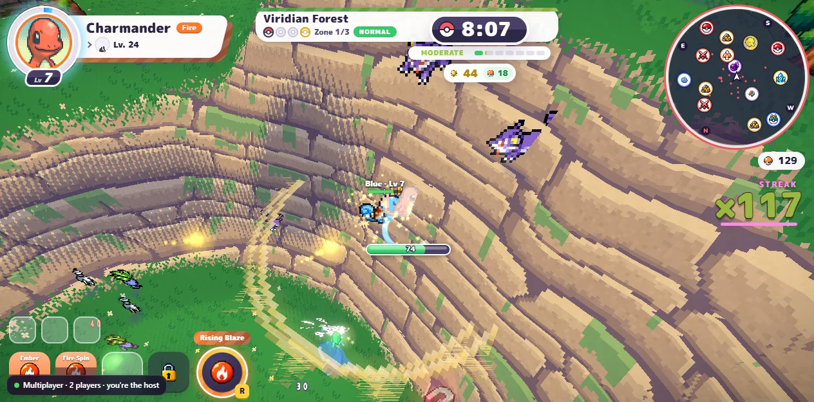
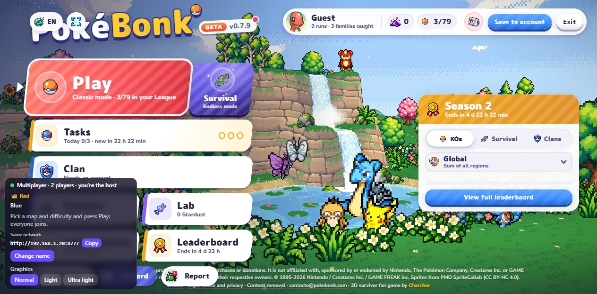
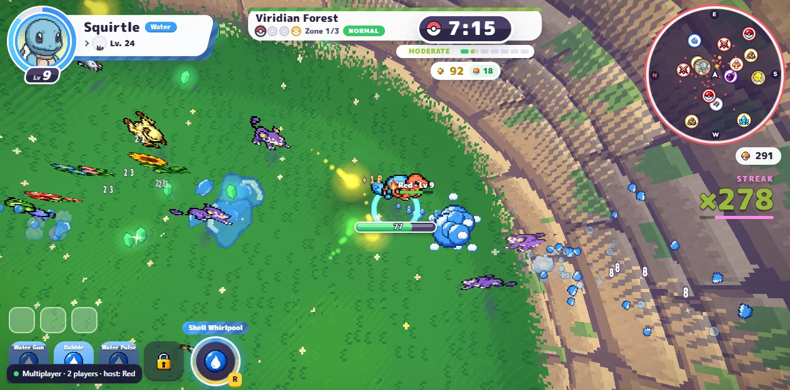
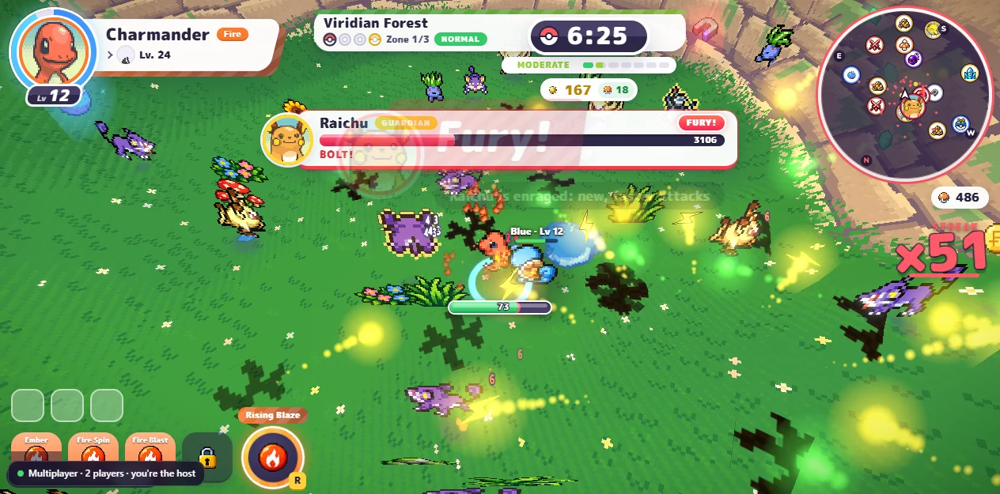
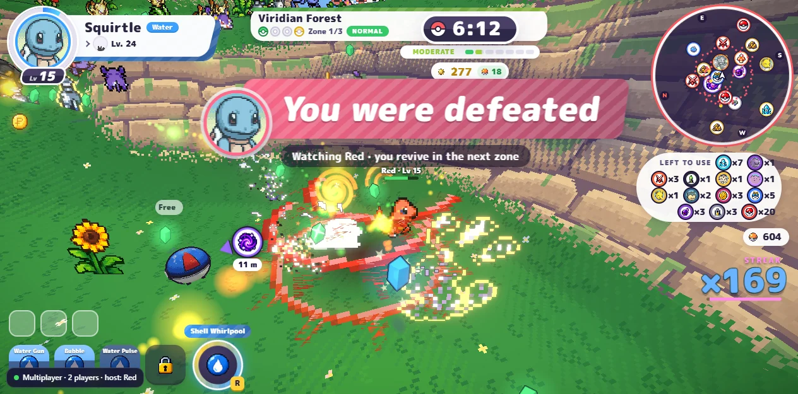
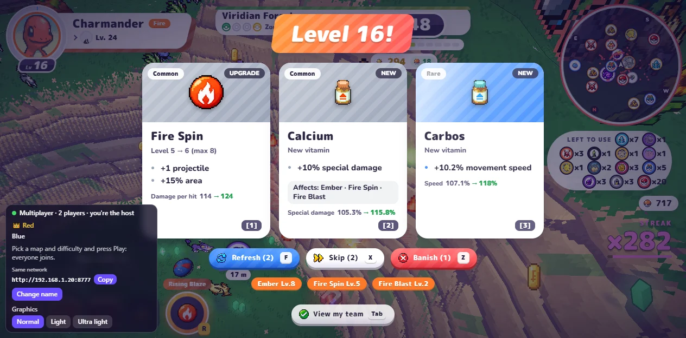
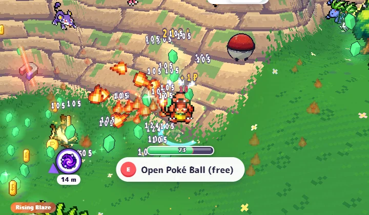
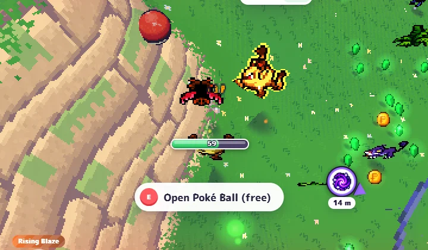

# PokéBonk Multiplayer

**Unofficial co-op multiplayer for [PokéBonk](https://pokebonk.com).** Play the same run with your friends, on the same Wi-Fi or over the internet with a single link. Your friends don't install anything: they open the link in their browser.



> This is a fan-made mod. It is not affiliated with PokéBonk, its creator, Nintendo, The Pokémon Company or Game Freak. It does not include any of the game's files: the game is loaded from pokebonk.com on the host's PC, and nothing is sent to PokéBonk's servers or leaderboards. Go play and support [the original game](https://pokebonk.com).

---

## Features

- **Shared world.** Enemies, bosses, waves and events are the same for everyone. Each enemy chases the closest player.
- **Personal progress.** Levels, upgrades, moves, items, gold, Poké Balls and captures belong to each player. Everyone gets their share of experience and loot from every enemy that falls, no matter who killed it.
- **Leveling up doesn't pause the game.** The world keeps going, and you can't be hurt while a menu is open.
- **One portal for everyone.** When anyone enters the portal, the whole team moves to the next zone. Anyone can summon the boss at its altar.
- **Spectate and revive.** If you fall, you watch your teammates (Tab or click to switch) and come back in the next zone. The run ends when everyone is down.
- **Harder with more players.** Each extra player gives enemies +70% health, makes them 45% more numerous and 10% stronger. Experience per kill is adjusted so you level at about the same pace as solo.
- **See each other.** Teammates show up with their Pokémon, name, level and health bar. You see their attacks, projectiles and effects too.
- **Graphics modes for weak PCs.** Each player can pick Normal, Light or Ultra light. This only changes their own screen.
- **Same network or internet.** Use your local address, or get a free public link through a Cloudflare tunnel (no account needed).
- **Progress is saved** on the host's PC (stardust, captures, unlocks), separately from your official account.

## Screenshots

| Lobby: everyone joins when the host presses Play | Your friend's view, with your name tag |
| --- | --- |
|  |  |
| **Boss fights hit everyone** | **Fall, spectate, revive in the next zone** |
|  |  |
| **Everyone levels up and picks upgrades on their own** | **Graphics: Normal (left) and Ultra light (right)** |
|  |   |

---

## What you need

- **The host** (the PC that runs the server): Windows, macOS or Linux with [Node.js](https://nodejs.org) 18 or newer (the LTS version) and an internet connection. The host should be the most powerful PC: it simulates every enemy.
- **Friends**: just a modern browser (Chrome, Edge, Firefox…) on a PC.

## Quick start (Windows)

1. Install **Node.js LTS** from [nodejs.org](https://nodejs.org) (default options are fine).
2. Download this project: green **Code** button → **Download ZIP**, then right-click the ZIP → **Extract All**.
3. Open the extracted folder and double-click **`Start PokeBonk Multiplayer.bat`**.
   - If Windows SmartScreen appears: **More info → Run anyway**.
   - If the firewall asks about Node.js: tick **Private networks** and click **Allow**.
4. Choose how you're playing:
   - **1**: everyone is on the same network (same house or Wi-Fi).
   - **2**: friends are somewhere else. You get an internet link to send them.
5. Keep that black window open while you play. It shows the addresses:

   ```text
   PokéBonk Multiplayer is running.
     You (host):                  http://localhost:8777
     Friends on your network:     http://192.168.1.20:8777
     PokéBonk version in use:     build mvgy3iyx (0.7.10, latest)
   ```

6. **You** open `http://localhost:8777` in your browser.
7. **Your friends** open the address from step 5, or the internet link if you chose option 2. Both are also shown in the in-game panel with a **Copy** button.

## Quick start (macOS / Linux)

```bash
npm install
npm start                 # same network
npm run start:internet    # also open a public link for friends elsewhere
```

## How to play

1. Everyone enters as a guest (or with a name), clicks the **Multiplayer** panel at the bottom left and sets their name.
2. Everyone picks their Pokémon in the menu.
3. The host picks the map and difficulty and presses **Play**. Everyone is pulled into the same run.
4. If someone joins later or reloads the page, they press **Play** and land in the host's current zone, starting from level 1.

The panel shows who's connected (👑 marks the host), the join links and your frame rate.

## Playing over the internet

Pick option **2** in the launcher (or run `npm run start:internet`).

- The first time, it downloads **cloudflared**, Cloudflare's official tunnel tool (about 40 MB, into the `bin` folder). It's free and needs no account.
- After a few seconds you get a link like `https://random-words.trycloudflare.com`. Send it to your friends.
- The link changes every time you start the server.
- Anyone with the link can join, so share it only with your friends.
- The first load is slower because the game is served from your PC. Over the internet there's a bit more delay than at home, and your upload speed is shared by everyone connected.

## Graphics modes (if the game lags)

Open the **Multiplayer** panel → **Graphics**. Each player picks their own:

| Mode | What it does |
| --- | --- |
| **Normal** | The game as it ships. |
| **Light** | No post-processing (outlines, bloom), 75% resolution, closer fog so far-away chests and altars aren't drawn, fewer particles. |
| **Ultra light** | Same as Light at 50% resolution (pixelated), even closer fog, a steady 30 fps cap and no damage numbers. |

PCs with integrated Intel or AMD graphics start in **Light** automatically the first time. If the game runs slowly in Normal, it suggests switching.

## Troubleshooting

**"No connection to the server" when the game opens.** Make sure the black window is still open, then reload the page. If you just updated the mod, reload with `Ctrl+F5`.

**Friends can't connect on the same network.**
- Check they're on the same Wi-Fi as the host and use the address shown in the black window, not `localhost`.
- Allow Node.js in the Windows firewall for private networks.
- Guest Wi-Fi networks often block devices from seeing each other: use option **2** (internet) instead.

**A warning says PokéBonk was updated.** The mod patches the game when it loads it. A big PokéBonk update can change the parts it patches. Check for a newer version of this mod. The mod keeps using the copy of the game it already downloaded, so an update doesn't break a working install.

**It lags.** Try the **Light** or **Ultra light** graphics modes on the slow PC. Make sure the host is the strongest PC.

**The host minimized the game.** That's fine: the world keeps running. If the host closes the tab, the run ends for everyone.

---

## How it works

PokéBonk is a single-player browser game. This project adds multiplayer around it without shipping any of its files:

- **`server.js`** downloads the game from pokebonk.com the first time each file is needed and keeps a copy in `cache/`. It serves the game to everyone, patches it as it's served, and stays on the build it first downloaded.
- **`patches.js`** makes a few small, targeted changes to the game's code: it exposes the running game to the mod, uses the host's seed and map for every player, makes enemies chase the nearest player, and stops defeated players from attacking. If an update makes a patch stop matching, the server and the in-game panel say so.
- **`api.js`** is a local stand-in for PokéBonk's account server. Profiles live in `data/accounts.json` on the host. Runs are never uploaded or ranked.
- **`relay.js`** is the WebSocket hub that connects the players, with heartbeats and reconnect handling.
- **`client/world.js`**: the host's browser simulates the world and streams compact binary snapshots of every enemy (about 15 per second). The other players mirror them, resolve contact damage locally, and send back the damage, statuses and knockback they cause.
- **`client/combat.js`**: boss and miniboss attacks aimed at a teammate are resolved against a stand-in for that player and sent to them. Enemy projectiles and visual effects are replicated, and so are everyone's own projectiles, as visuals.
- **`client/net.js`**: the lobby, run start, shared portal, other players and their name tags, death and spectating, difficulty scaling and the in-game panel.
- **`client/perf.js`**: the graphics modes.
- **`tunnel.js`**: the optional Cloudflare quick tunnel for internet play.

For development, `http://localhost:8777/lan/test.html` opens two game instances side by side (host and friend).

### Project layout

```text
server.js        game server, game file cache, patching
patches.js       the game patches
api.js           local account/profile service
relay.js         multiplayer WebSocket relay
tunnel.js        optional internet link (Cloudflare)
client/          code injected into the game page
docs/            screenshots
Start PokeBonk Multiplayer.bat   Windows launcher
```

Created at runtime, never committed: `cache/` (game files), `data/` (local profiles) and `bin/` (cloudflared).

## Privacy

- Nothing is sent to PokéBonk's account servers or leaderboards. The game files are downloaded from pokebonk.com, just like when you play it normally.
- Player profiles are stored only on the host, in `data/accounts.json`. No passwords: names are trusted on your own network.
- Internet mode goes through a temporary Cloudflare tunnel that closes when you close the server.

## License

The code in this repository is released under the [MIT License](LICENSE). It covers only this mod's code. PokéBonk, its code and assets, and Pokémon belong to their respective owners and are not included here.
